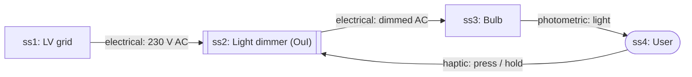

# HTD Test Case: fields, order, focus checks

Source: ERIGrid 2.0 Holistic Test Description, https://github.com/ERIGrid2/holistic-test-description (`Templates/ERIGrid2_Test_Description_Template.docx`, `Guidelines/ERIGrid_Holistic_Test_Description_and_Procedure_Guideline.pdf`). Worked example: `Examples/BASIC_Light_Dimmer/`.

## Header

Test Case ID (`TC##` or a short name, e.g. `LightDimmer`), Author, Project, Version, Date. Show it as a single confirmation line, never as a numbered question.

## Fields in dependency order

A field enters the frontier once the fields it depends on are settled. The order deliberately clarifies the **SuT before the PoIs**: the Narrative carries the objectives in plain words, the OuI and SuT are pinned down (with a figure), and only then are the objectives sharpened into typed PoIs against the functions the SuT actually offers. Sharpened PoIs often reshape the SuT in turn; re-open it when they do.

| # | Field | Definition (template wording) | Depends on | A good answer looks like |
|---|---|---|---|---|
| 1 | **Name of the Test Case** | Short title. | — | Names the object and the concern: "Light Dimmer", "Coordinated Voltage Control in MV feeder". |
| 2 | **Narrative** | Free text incl. use case and test objectives. | — | A few sentences: who uses the thing, in what situation, and the objectives in plain words. No equipment. |
| 3 | **Object under Investigation (OuI)** | The component(s) (1..n) to be qualified by the test. | 2 | Identified by a system boundary, not only a function name ("the controller" is ambiguous: OuI or FuI?). |
| 4 | **System under Test (SuT)** | Systems, subsystems, components included in the test case or setup. | 3 | The OuI plus everything it must be embedded in, named as **subsystems** (`ss1`, `ss2`…) so phase 2 can make one the OuI of a Test Specification, with a **SuT figure** (below). Flag subsystems with unknown dynamics. |
| 5 | **Domain under Investigation (DuI)** | Relevant domains or sub-domains of test parameters and connectivity. | 4 | Electrical, thermal, ICT, market, haptic… with sub-domain ("LV distribution, 50 Hz"). Every connection type in the SuT figure belongs to a listed domain. |
| 6 | **Function(s) under Investigation (FuI)** | The referenced specification of a function realized by the OuI. | 2, 3 | Each FuI as behaviour, ideally with its reference (datasheet, grid code, requirement ID). |
| 7 | **Functions under Test (FuT)** | Functions relevant to the SuT's operation, incl. FuI and OuI–SuT interactions. | 4, 6 | FuI plus supporting functions, each attached to the subsystem that realizes it, with sub-FuTs where a function decomposes. |
| 8 | **Purpose of Investigation (PoI)** | The test purpose in terms of **Characterization**, **Verification**, or **Validation**. | 2, 6, 7 | The Narrative's objectives sharpened into a numbered list of peers, each starting with its verb and naming the FuI or FuT it concerns. *Characterize* = quantify a property, no pass/fail. *Verify* = check against a specification. *Validate* = check fitness for the real use case or user need. |
| 9 | **Test Criteria (TCR)** | Criteria for each PoI based on properties of the SuT; encompasses test signals and output measures. | 4, 7, 8 | Usually several per PoI, each labelled with its PoI and the subsystem whose property it judges. A TCR not directly quantifiable gets sub-criteria (a TCR hierarchy). |
| 10 | **Target Metrics (TM)** | Measures required to quantify each test criterion. | 9 | Quantity, unit, quantitative/qualitative: "Voltage deviation [p.u.], quantitative". |
| 11 | **Variability Attributes (VA)** | Controllable or uncontrollable factors and the required variability; ref. to PoI. | 4, 9 | Each factor marked controllable/uncontrollable, with range or distribution, the PoI it matters for, and where it enters the SuT. |
| 12 | **Quality Attributes (QA)** | Threshold levels for test-result quality and pass/fail criteria. | 8, 10 | Pass/fail threshold per metric for Verify/Validate PoIs; result quality (confidence, repetitions, accuracy) for all. |
| 13 | **Qualification Strategy** | How the PoIs are met by the tests and how results combine into the PoI outcomes. | 4, 8–12 | Filled in phase 2, per `QUALIFICATION.md`. |

## SuT figure

The SuT is settled only with a figure. Two sources:

- **The user's own figure.** Ask for one when the SuT question first comes up. Read the image, list the subsystems and connections you see, and ask about anything ambiguous. Reference it by path; keep its labels and the `ssN` list in sync, and turn every mismatch into a question.
- **A drafted figure.** Without one, draft a Mermaid diagram and refine it each round with the user:

Conventions: one node per subsystem labelled `ssN: name`; the OuI as a double-bordered node `[[…]]`; actors and environment as rounded nodes `([…])`; every edge labelled `domain: what flows`. The edge domains must match the DuI. Print the figure whenever the SuT changes, not every round.

In phase 2, each Test Specification's *Specific Test System* is drawn as the subset of this figure it uses, with that TS's OuI double-bordered.

## Focus checks

Run these every round, on settled and draft values. A failed check becomes a question.

- **Narrative covers the PoIs.** Every PoI traces to an objective in the Narrative, and every objective there has a PoI.
- **PoI typed.** Every PoI starts with Characterize, Verify, or Validate.
- **Verify has a spec.** Every *Verify* PoI points at a FuI with a referenced specification.
- **Validate has a user need.** Every *Validate* PoI is anchored in the Narrative's use case.
- **OuI bounded.** The OuI is a system boundary, distinct from its FuI.
- **Traceability.** PoI → OuI/FuI; TCR → PoI; TM → TCR; QA → TM. No orphans in either direction; every PoI has at least one TCR.
- **SuT is minimal.** Every SuT element is needed to exercise a FuT or produce a VA.
- **SuT figure agrees.** Every `ssN` appears in the figure, every edge domain is in the DuI, and every FuT sits on a subsystem in the figure.
- **Measurable.** Every TM can, in principle, be measured or computed from the SuT. Propose a standard metric where one exists.
- **Level discipline.** Lab names, equipment models, step sequences, sample rates and initial states are parked as seeds.
